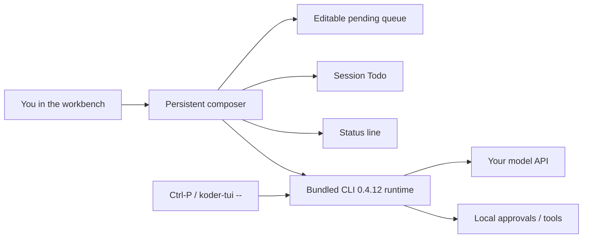

# Koder TUI

[English](README.md) · [中文](README.zh-CN.md) · **v0.3.1**

[](https://github.com/KarmenLoop/koder-tui/releases/tag/tui-0.3.1)
[](EULA.md)
[](docs/GETTING-STARTED.md)
[](https://github.com/KarmenLoop/koder-cli)
[](#snapshot)

**An independent terminal workbench for Koder—keep writing while an agent works, steer the current turn, order the next tasks, and follow a live checklist without losing the conversation.**

Koder TUI wraps the complete [Koder CLI](https://github.com/KarmenLoop/koder-cli) runtime in a persistent composer, editable task queue, session Todo panel, command search, and configurable status line. Profiles and workspace rules stay shared with the CLI. You bring your own model API; installing the workbench does not sign in to a service or approve an external action.

Built and maintained by [KarmenLoop](https://github.com/KarmenLoop) / [KARMENLOOP](https://karmenloop.com). Current release: **[tui-0.3.1](https://github.com/KarmenLoop/koder-tui/releases/tag/tui-0.3.1)**. Agreement: **[Koder-EULA-1.1](EULA.md)** — personal, noncommercial local use is free; commercial use and organizational deployment need separate written permission.

[Download 0.3.1](https://github.com/KarmenLoop/koder-tui/releases/tag/tui-0.3.1) · [Website](https://karmenloop.com/tui.html) · [Tutorial (EN)](docs/tutorial.en.md) · [中文教程](docs/tutorial.zh-CN.md) · [Getting started](docs/GETTING-STARTED.md) · [Release notes](RELEASE-NOTES.md) · [Release validation](docs/RELEASE-VALIDATION.md)

---

## Why this exists

A coding agent in a plain terminal often forces a trade-off: either you wait while it streams, or you lose the session when you interrupt. Queuing the next prompt, reordering work, and watching a session checklist usually means juggling extra windows or abandoning the conversation.

Koder TUI treats the terminal as a **workbench around the complete CLI**:

- the composer stays open during streaming;
- you can steer, interrupt, or queue without closing the session;
- Todo, status, and CLI routes stay one keystroke away;
- the same profile and approvals you already use with Koder CLI still apply.

It does not replace the CLI. It does not claim a signed desktop app, Linux bundle, or Windows ARM64 build in this release.

---

## Snapshot

| | |
|---|---|
| **What you install** | Platform archive (bundled Node.js **22.23.3**) or per-user installer that adds a `koder-tui` command |
| **What you bring** | Your own model provider / engine (same setup as Koder CLI), or an existing Koder profile |
| **Version** | **TUI 0.3.1** (tag `tui-0.3.1`) · bundled **CLI 0.4.12** |
| **Platforms in this release** | Windows 10/11 **x64** · macOS **Apple Silicon** · macOS **Intel** |
| **Not in this release** | Windows ARM64 native · Linux bundles · MSI / EXE / PKG / DMG · signed or notarized desktop apps |
| **License** | **Koder-EULA-1.1** (proprietary end-user license; same agreement as Koder CLI) |
| **Personal use** | Free for personal, noncommercial local use |
| **Commercial / org** | Separate prior written authorization (`info@karmenloop.com`) |
| **Public GitHub tree** | Installers, docs, notices, release checks — new proprietary development source is outside the public branch ([SOURCE-STATUS.md](SOURCE-STATUS.md)) |
| **Install locations** | Portable: extract and launch · macOS installed: `~/.koder-tui/versions` + `~/.local/bin/koder-tui` · Windows installed: `%LOCALAPPDATA%\koder-tui` + user PATH |

---

## Is / Is not

| Is | Is not |
|---|---|
| Independent **terminal workbench** around the full Koder CLI runtime | A separate coding agent with different approvals or a different profile model |
| Persistent composer, editable queue, Todo, status line, command search | Signed / notarized GUI desktop application |
| Free personal noncommercial local use under Koder-EULA-1.1 | Open-source grant for the proprietary workbench implementation |
| Official archives with SHA-256 verification and installer EULA acceptance | Silent license accept, or permission to redistribute proprietary runtime |
| Windows x64 + macOS arm64/x64 packages with bundled Node | Linux or Windows ARM64 packages in **0.3.1** |
| Shared CLI profile, MCP, Skills, and 58 CLI routes via `Ctrl-P` / `koder-tui -- …` | Replacement for CLI `/update` / `/uninstall` managing the TUI archive |
| Honest NOT_RUN boundaries for IME, live providers, ACP, accessibility | Claim that hosted CI certifies every terminal, input method, or model quality |

---

## A workbench around the complete CLI

Koder TUI bundles the Koder CLI **0.4.12** runtime, its KARMEN LOOP engine, configuration, business modules, documentation, MCP and Skills support. It adds a persistent composer, an editable task queue, a session Todo panel, command search, and a configurable status line. The default profile and workspace rules are shared with the CLI.

- **Keep the composer open.** Type during streaming. Press **Ctrl-S** to steer the active turn; **Esc** or **Ctrl-C** interrupts it without closing the workbench.
- **Order upcoming work.** **Alt-Q** queues a draft. **Ctrl-Q** focuses the queue; **Alt-Up/Down** changes its order and **Delete** removes the selected item.
- **Follow session progress.** **Ctrl-T** expands or collapses Todo. The running task and queued prompts are separate. `/undo` restores conversation and Todo state, while retaining records of effects that already occurred.
- **See the essentials.** Configure mode, goal, model, tasks, cwd, git and tips through `/statusline`. An unconfigured model still has a slot; unknown context usage is shown as unknown.
- **Find commands.** `/help` contains 79 entries, including aliases and workbench commands. **Ctrl-P** searches 58 CLI routes. Use `koder-tui -- <CLI arguments>` for exact CLI access.
- **Responsive input (0.3.1).** Typing or pasting returns from queue navigation to the composer without losing the first character. Input is prioritized over background refreshes, and streamed output reuses completed lines. The decorative loop has been removed.

Some CLI modules temporarily take over the terminal for their own interactive screens, then return to the workbench. External engines expose Todo and undo only when their adapters support them.



---

## Install

Download a platform archive from the [tui-0.3.1 release](https://github.com/KarmenLoop/koder-tui/releases/tag/tui-0.3.1), extract it, and open `koder-tui.command` on macOS or `koder-tui.cmd` on Windows. Each archive includes Node.js; no npm install is needed.

| Computer | Archive |
| --- | --- |
| Windows 10/11 x64 | `koder-tui-0.3.1-windows-x64.zip` |
| Mac with Apple Silicon | `koder-tui-0.3.1-macos-arm64.tar.gz` |
| Mac with Intel processor | `koder-tui-0.3.1-macos-x64.tar.gz` |

Verify against the release [SHA256SUMS](https://github.com/KarmenLoop/koder-tui/releases/download/tui-0.3.1/SHA256SUMS): `shasum -a 256 <archive>` on macOS, or `Get-FileHash <archive> -Algorithm SHA256` on Windows. These packages are terminal distributions, not MSI/EXE/PKG/DMG installers, and are not signed or notarized desktop applications.

For a persistent `koder-tui` command, use the matching installer from the release:

**macOS**

```bash
curl -fL https://github.com/KarmenLoop/koder-tui/releases/download/tui-0.3.1/koder-tui.sh -o koder-tui.sh
bash koder-tui.sh
```

**Windows PowerShell**

Download [the Windows installer](https://karmenloop.com/install/tui-0.3.1/koder-tui.cmd) in your browser and open it, or run:

```powershell
[Net.ServicePointManager]::SecurityProtocol = [Net.SecurityProtocolType]::Tls12
$installer = Join-Path $env:TEMP ('koder-tui-' + [guid]::NewGuid().ToString('N') + '.ps1')
try {
  Invoke-WebRequest -UseBasicParsing https://karmenloop.com/install/tui-0.3.1/koder-tui.ps1 -OutFile $installer -ErrorAction Stop
  powershell.exe -NoProfile -ExecutionPolicy Bypass -File $installer
} catch {
  Write-Error 'Download failed. Open the Windows installer link in your browser.'
}
```

Review the script and license before running it. The installer verifies the archive's SHA-256, installs under your user account, asks for EULA acceptance, and leaves an existing `koder` command intact. Unattended install requires reading and accepting the terms first, then `KODER_TUI_EULA_ACCEPT=1`. Reopen your terminal after installation. On macOS, add `~/.local/bin` to PATH if it is not already there.

Full walkthrough: [Tutorial (EN)](docs/tutorial.en.md) · [中文教程](docs/tutorial.zh-CN.md) · keyboard reference in [GETTING-STARTED.md](docs/GETTING-STARTED.md).

---

## First session

1. Run `koder-tui --version`. Expect **TUI 0.3.1** and **CLI 0.4.12**.
2. Run `koder-tui -- setup` to configure a model, or reuse an existing Koder profile.
3. Run `koder-tui -w /path/to/project` (quote Windows paths that contain spaces).
4. Enter a request. Review any permission prompt before approving a tool.
5. Use `/help`, **Ctrl-P**, or `koder-tui -- help` to discover commands.

Provider credentials and tool permissions remain under your control. For a separate profile, set `KODER_CLI_HOME` to a different directory before launching. Do not point an untrusted project at a credential directory. No model account is included.

---

## Updates, compatibility, and removal

Re-run the current TUI installer to update the workbench. **TUI and CLI have separate release versions.** CLI `/update`, automatic-update settings and `/uninstall` retain their original CLI behavior and can act on an existing CLI installation; they do **not** manage the TUI archive.

If an updated CLI lacks embedding API 2, the saved conversation continues in its native terminal. Restart `koder-tui` to reopen this bundled workbench. For predictable portable use, set `KODER_AUTO_UPDATE=0` for that process; this does not change saved settings.

- **Rollback (installed):** run a previous version’s launcher under the installation’s `versions` directory.
- **Remove portable:** close the workbench and delete the extracted directory.
- **Remove installed (macOS):** close all TUI sessions; remove `~/.local/bin/koder-tui` and `~/.koder-tui`.
- **Remove installed (Windows):** close all TUI sessions; remove `%LOCALAPPDATA%\koder-tui` and its bin entry from your user PATH.

Keep the separate Koder CLI profile if you want to preserve settings and conversations. Do **not** use `/uninstall --purge` to remove only the TUI.

---

## What this public repository contains

This public repository provides installers, release checks, documentation and licensing notices. New proprietary development source is maintained outside the public branch. Runtime distributions, including readable scripts needed to run the product, are release assets under the applicable licenses. Earlier commits remain accessible; see [SOURCE-STATUS.md](SOURCE-STATUS.md) for the exact boundary.

| Doc | Use it when you need… |
|---|---|
| [Tutorial EN](docs/tutorial.en.md) · [中文](docs/tutorial.zh-CN.md) | Prerequisites, install, first task, update, rollback, removal |
| [GETTING-STARTED.md](docs/GETTING-STARTED.md) | Package table, keyboard map, Todo/undo notes, Windows download errors |
| [RELEASE-NOTES.md](RELEASE-NOTES.md) | What changed in 0.3.1 |
| [RELEASE-VALIDATION.md](docs/RELEASE-VALIDATION.md) | Hosted checks vs NOT_RUN device limits |
| [SOURCE-STATUS.md](SOURCE-STATUS.md) | Public tree vs proprietary runtime boundary |
| [EULA.md](EULA.md) · [LICENSE](LICENSE) | Koder-EULA-1.1 and scope note |
| [THIRD_PARTY_NOTICES.md](THIRD_PARTY_NOTICES.md) | Third-party licenses shipped in every archive |

---

## Validation honesty

Before packaging 0.3.1, 43 private regression tests and seven real macOS PTY interaction checks passed. Hosted package jobs checked archive hashes, bundled runtime, all 58 CLI routes, queue-focus typing, Unicode paste, input during streaming, and isolated installation. A local fixture measurement (P95 key-to-render) is documented in the release notes; it measures that fixture, not every terminal or input method.

**NOT_RUN unless recorded elsewhere:** user-device Windows/macOS terminal and IME acceptance, live providers and external ACP adapters, account writes, cross-device migration, accessibility. Hosted Windows tests are not a substitute for those device checks. See [docs/RELEASE-VALIDATION.md](docs/RELEASE-VALIDATION.md) and `release-validation.json`.

---

## FAQ

### What is Koder TUI, in one sentence?

A proprietary terminal workbench that embeds the full Koder CLI runtime so you can keep composing, queue tasks, and follow session Todo while an agent works—under the same local approvals and profile as the CLI.

### Do I need Koder CLI installed separately?

No. Each TUI archive bundles CLI **0.4.12** and Node.js. An existing `koder` command and profile are left intact if you already have them; the products version independently.

### Is this open source?

No. Current TUI distributions identify **Koder-EULA-1.1**—a proprietary end-user license. Personal, noncommercial local use is free. Readable runtime files in the archive do not grant rights to modify, repackage, or redistribute proprietary implementation beyond the EULA. Third-party and legacy CLI GPL grants remain intact where they already applied ([SOURCE-STATUS.md](SOURCE-STATUS.md)).

### Can my company deploy it?

Contact [info@karmenloop.com](mailto:info@karmenloop.com) for commercial or organizational authorization. Stars, downloads, and inquiry emails alone are not permission.

### Does `/undo` reverse file writes?

No. `/undo` restores saved conversation and Todo metadata. Completed tool effects (file writes, messages, purchases, and similar) keep their records and are not rolled back by undo.

### Why does Ctrl-S not steer on my Mac?

Some terminals intercept Ctrl-S for software flow control. Run `stty -ixon`, or use the workbench slash commands. Configure Option/Alt if the terminal eats queue shortcuts.

### Soft discoverability

Phrases that match this repo: **Koder terminal workbench**, **Koder TUI Windows macOS**, **persistent composer coding agent**, **terminal task queue Todo**, **Koder-EULA local coding agent UI**. Substance lives in the release assets and docs—not keyword density.

---

## License and support

Free for personal, noncommercial local use under [Koder-EULA-1.1](EULA.md). Commercial use, organizational deployment, and changes to proprietary implementation require separate permission. Third-party licenses remain intact and ship in every archive.

[Third-party notices](THIRD_PARTY_NOTICES.md) · [Copyright notice](LEGAL-NOTICE.md) · [Source status](SOURCE-STATUS.md) · [Report an issue](https://github.com/KarmenLoop/koder-tui/issues)

Maintainer: [KarmenLoop](https://github.com/KarmenLoop) · Site: [karmenloop.com/tui.html](https://karmenloop.com/tui.html) · Email: [info@karmenloop.com](mailto:info@karmenloop.com)

Related: [Koder CLI](https://github.com/KarmenLoop/koder-cli) (same EULA family; separate version line).

Copyright © KARMEN / Koder and the respective copyright holders.
