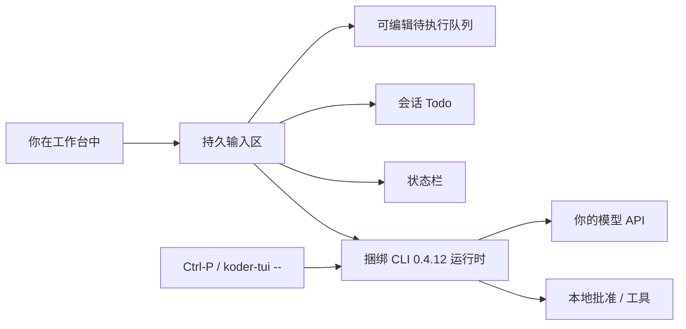

# Koder TUI

[English](README.md) · [中文](README.zh-CN.md) · **v0.3.1**

[](https://github.com/KarmenLoop/koder-tui/releases/tag/tui-0.3.1)
[](EULA.md)
[](docs/GETTING-STARTED.md)
[](https://github.com/KarmenLoop/koder-cli)
[](#一览)

**面向 Koder 的独立终端工作台——代理在跑时你仍可继续输入，纠偏当前回合、编排后续任务、跟进实时清单，而不丢会话。**

Koder TUI 把完整的 [Koder CLI](https://github.com/KarmenLoop/koder-cli) 运行时包进持久输入区、可编辑任务队列、会话 Todo 面板、命令搜索与可配置状态栏。配置档与工作区规则与 CLI 共用。模型 API 由你自备；安装工作台不会登录任何服务，也不会替你批准外部动作。

由 [KarmenLoop](https://github.com/KarmenLoop) / [KARMENLOOP](https://karmenloop.com) 维护。当前发布：**[tui-0.3.1](https://github.com/KarmenLoop/koder-tui/releases/tag/tui-0.3.1)**。协议：**[Koder-EULA-1.1](EULA.md)**——个人非商业本地使用免费；商业使用与组织部署需另行书面授权。

[下载 0.3.1](https://github.com/KarmenLoop/koder-tui/releases/tag/tui-0.3.1) · [产品页](https://karmenloop.com/tui.html) · [English tutorial](docs/tutorial.en.md) · [中文教程](docs/tutorial.zh-CN.md) · [入门与快捷键](docs/GETTING-STARTED.md) · [发行说明](RELEASE-NOTES.md) · [发行验证](docs/RELEASE-VALIDATION.md)

---

## 为什么做这个

纯终端里的编码代理常逼你二选一：要么干等流式输出，要么一打断就丢会话。要排队下一条提示、重排任务、盯会话清单，往往只能另开窗口，或干脆放弃当前对话。

Koder TUI 把终端当作**包住完整 CLI 的工作台**：

- 流式输出时输入区仍可用；
- 可纠偏、可中断、可排队，而不必关掉会话；
- Todo、状态栏与 CLI 路由一键可达；
- 你已在 Koder CLI 里用的配置档与批准规则继续生效。

它不替代 CLI。本发行不宣称已签名的桌面应用、Linux 包或 Windows ARM64 原生构建。

---

## 一览

| | |
|---|---|
| **你安装什么** | 平台压缩包（内含 Node.js **22.23.3**），或为用户安装并添加 `koder-tui` 命令的安装脚本 |
| **你自备什么** | 自己的模型提供商 / 引擎（与 Koder CLI 同一套 setup），或已有 Koder 配置档 |
| **版本** | **TUI 0.3.1**（标签 `tui-0.3.1`）· 捆绑 **CLI 0.4.12** |
| **本发行平台** | Windows 10/11 **x64** · macOS **Apple Silicon** · macOS **Intel** |
| **本发行未提供** | Windows ARM64 原生 · Linux 包 · MSI / EXE / PKG / DMG · 已签名或公证的桌面应用 |
| **许可** | **Koder-EULA-1.1**（专有最终用户许可；与 Koder CLI 同一协议） |
| **个人使用** | 个人非商业本地使用免费 |
| **商业 / 组织** | 需事先书面授权（`info@karmenloop.com`） |
| **公开 GitHub 树** | 安装脚本、文档、声明、发行检查——新专有开发源码在公开分支之外（[SOURCE-STATUS.md](SOURCE-STATUS.md)） |
| **安装位置** | 便携：解压即用 · macOS 安装版：`~/.koder-tui/versions` + `~/.local/bin/koder-tui` · Windows 安装版：`%LOCALAPPDATA%\koder-tui` + 用户 PATH |

---

## 是 / 不是

| 是 | 不是 |
|---|---|
| 围绕完整 Koder CLI 运行时的独立**终端工作台** | 另一套批准规则或另一套配置模型的独立编码代理 |
| 持久输入区、可编辑队列、Todo、状态栏、命令搜索 | 已签名 / 公证的 GUI 桌面应用 |
| 在 Koder-EULA-1.1 下个人非商业本地免费使用 | 对专有工作台实现的开源授权 |
| 带 SHA-256 校验与安装脚本 EULA 确认的官方包 | 静默接受许可，或允许再分发专有运行时 |
| Windows x64 + macOS arm64/x64（捆绑 Node） | **0.3.1** 中的 Linux 或 Windows ARM64 包 |
| 共享 CLI 配置档、MCP、Skills，以及经 `Ctrl-P` / `koder-tui -- …` 的 58 条 CLI 路由 | 用 CLI 的 `/update` / `/uninstall` 管理 TUI 压缩包 |
| 对 IME、真实提供商、ACP、无障碍等诚实标注 NOT_RUN | 宣称托管 CI 可证明每台终端、输入法或模型质量 |

---

## 包住完整 CLI 的工作台

Koder TUI 捆绑 Koder CLI **0.4.12** 运行时、KARMEN LOOP 引擎、配置、业务模块、文档、MCP 与 Skills 支持，并增加持久输入区、可编辑任务队列、会话 Todo 面板、命令搜索与可配置状态栏。默认配置档与工作区规则与 CLI 共用。

- **输入区保持打开。** 流式输出时仍可输入。**Ctrl-S** 纠偏当前回合；**Esc** 或 **Ctrl-C** 中断动作但不关闭工作台。
- **编排后续工作。** **Alt-Q** 把草稿加入待执行队列。**Ctrl-Q** 聚焦队列；**Alt-Up/Down** 调整顺序，**Delete** 删除选中项。
- **跟进会话进度。** **Ctrl-T** 展开/折叠 Todo。正在执行的任务与排队提示彼此独立。`/undo` 恢复对话与 Todo 状态，并保留已发生效果的记录。
- **看见关键信息。** 用 `/statusline` 配置模式、目标、模型、任务、cwd、git 与提示。未配置的模型仍占位；未知的上下文用量显示为 unknown。
- **查找命令。** `/help` 含 79 条（含别名与工作台命令）。**Ctrl-P** 搜索 58 条 CLI 路由。精确 CLI 访问用 `koder-tui -- <CLI 参数>`。
- **响应式输入（0.3.1）。** 在队列聚焦时打字或粘贴会回到输入区且不丢首字符。输入优先于后台刷新；流式输出复用已完成行。装饰性循环动画已移除。

部分 CLI 模块会临时接管终端做交互界面，结束后回到工作台。外部引擎仅在适配器支持时暴露 Todo 与 undo。



---

## 安装

从 [tui-0.3.1 发行页](https://github.com/KarmenLoop/koder-tui/releases/tag/tui-0.3.1) 下载对应平台压缩包，解压后在 macOS 打开 `koder-tui.command`，在 Windows 打开 `koder-tui.cmd`。每个压缩包已含 Node.js，无需 npm install。

| 电脑 | 压缩包 |
| --- | --- |
| Windows 10/11 x64 | `koder-tui-0.3.1-windows-x64.zip` |
| Apple Silicon Mac | `koder-tui-0.3.1-macos-arm64.tar.gz` |
| Intel Mac | `koder-tui-0.3.1-macos-x64.tar.gz` |

请对照发行页 [SHA256SUMS](https://github.com/KarmenLoop/koder-tui/releases/download/tui-0.3.1/SHA256SUMS) 校验：macOS 用 `shasum -a 256 <archive>`，Windows 用 `Get-FileHash <archive> -Algorithm SHA256`。这些是终端发行包，不是 MSI/EXE/PKG/DMG，也不是已签名或公证的桌面应用。

若需要持久的 `koder-tui` 命令，使用发行页中对应安装脚本：

**macOS**

```bash
curl -fL https://github.com/KarmenLoop/koder-tui/releases/download/tui-0.3.1/koder-tui.sh -o koder-tui.sh
bash koder-tui.sh
```

**Windows PowerShell**

在浏览器下载 [Windows 安装器](https://karmenloop.com/install/tui-0.3.1/koder-tui.cmd) 并打开，或执行：

```powershell
[Net.ServicePointManager]::SecurityProtocol = [Net.SecurityProtocolType]::Tls12
$installer = Join-Path $env:TEMP ('koder-tui-' + [guid]::NewGuid().ToString('N') + '.ps1')
try {
  Invoke-WebRequest -UseBasicParsing https://karmenloop.com/install/tui-0.3.1/koder-tui.ps1 -OutFile $installer -ErrorAction Stop
  powershell.exe -NoProfile -ExecutionPolicy Bypass -File $installer
} catch {
  Write-Error 'Download failed. Open the Windows installer link in your browser.'
}
```

运行前请审阅脚本与许可。安装器校验压缩包 SHA-256，安装到当前用户，要求接受 EULA，并保留已有的 `koder` 命令。无人值守安装须先阅读并接受条款，再设 `KODER_TUI_EULA_ACCEPT=1`。安装后请重新打开终端。macOS 若尚未配置，请将 `~/.local/bin` 加入 PATH。

完整步骤见 [English tutorial](docs/tutorial.en.md) · [中文教程](docs/tutorial.zh-CN.md)；快捷键见 [GETTING-STARTED.md](docs/GETTING-STARTED.md)。

---

## 第一次会话

1. 运行 `koder-tui --version`，应看到 **TUI 0.3.1** 与 **CLI 0.4.12**。
2. 运行 `koder-tui -- setup` 配置模型，或复用已有 Koder 配置档。
3. 运行 `koder-tui -w /path/to/project`（Windows 路径含空格时请加引号）。
4. 输入请求。批准任何工具前先审阅权限提示。
5. 用 `/help`、**Ctrl-P** 或 `koder-tui -- help` 发现命令。

提供商凭证与工具权限仍由你控制。若要独立配置档，启动前将 `KODER_CLI_HOME` 指到其他目录。不要把不信任的项目指向凭证目录。安装包不附带模型账号。

---

## 更新、兼容与卸载

重新运行当前 TUI 安装器即可更新工作台。**TUI 与 CLI 版本线独立。** CLI 的 `/update`、自动更新设置与 `/uninstall` 仍按原 CLI 行为，可作用于已有 CLI 安装；它们**不**管理 TUI 压缩包。

若更新后的 CLI 缺少 embedding API 2，已保存的对话会在其原生终端继续。重新启动 `koder-tui` 可打开本捆绑工作台。便携场景若需可预期行为，可为该进程设 `KODER_AUTO_UPDATE=0`；这不会改已保存设置。

- **回滚（安装版）：** 在安装目录的 `versions` 下运行旧版本启动器。
- **删除便携版：** 关闭工作台后删除解压目录。
- **删除安装版（macOS）：** 关闭全部 TUI 会话；删除 `~/.local/bin/koder-tui` 与 `~/.koder-tui`。
- **删除安装版（Windows）：** 关闭全部 TUI 会话；删除 `%LOCALAPPDATA%\koder-tui`，并从用户 PATH 去掉其 bin 项。

若要保留设置与会话，请保留独立的 Koder CLI 配置档。**不要**用 `/uninstall --purge` 只卸 TUI。

---

## 本公开仓库包含什么

本公开仓库提供安装脚本、发行检查、文档与许可声明。新专有开发源码在公开分支之外维护。运行时发行物（含运行产品所需的可读脚本）作为发行资产，适用相应许可。历史提交仍可访问；精确边界见 [SOURCE-STATUS.md](SOURCE-STATUS.md)。

| 文档 | 何时使用 |
|---|---|
| [Tutorial EN](docs/tutorial.en.md) · [中文](docs/tutorial.zh-CN.md) | 前置条件、安装、首任务、更新、回滚、卸载 |
| [GETTING-STARTED.md](docs/GETTING-STARTED.md) | 包表、快捷键、Todo/undo 说明、Windows 下载故障 |
| [RELEASE-NOTES.md](RELEASE-NOTES.md) | 0.3.1 变更 |
| [RELEASE-VALIDATION.md](docs/RELEASE-VALIDATION.md) | 托管检查 vs NOT_RUN 设备边界 |
| [SOURCE-STATUS.md](SOURCE-STATUS.md) | 公开树 vs 专有运行时边界 |
| [EULA.md](EULA.md) · [LICENSE](LICENSE) | Koder-EULA-1.1 与范围说明 |
| [THIRD_PARTY_NOTICES.md](THIRD_PARTY_NOTICES.md) | 随每个压缩包附带的第三方许可 |

---

## 验证诚实性

打包 0.3.1 前，43 项私有回归与 7 项真实 macOS PTY 交互检查通过。托管打包任务校验了压缩包哈希、捆绑运行时、全部 58 条 CLI 路由、队列聚焦打字、Unicode 粘贴、流式中输入，以及隔离安装。发行说明中的本地夹具测量（P95 按键到渲染）只描述该夹具，不保证每台终端或输入法。

**除非另有记录，否则仍为 NOT_RUN：** 用户设备上的 Windows/macOS 终端与 IME 验收、真实提供商与外部 ACP 适配器、账号写入、跨设备迁移、无障碍。托管 Windows 测试不能替代这些设备检查。详见 [docs/RELEASE-VALIDATION.md](docs/RELEASE-VALIDATION.md) 与 `release-validation.json`。

---

## 常见问题

### 一句话：Koder TUI 是什么？

把完整 Koder CLI 运行时装进终端工作台，让你在代理工作时继续输入、排队任务、跟进会话 Todo——批准与配置档与 CLI 相同。

### 必须另外安装 Koder CLI 吗？

不必。每个 TUI 压缩包已捆绑 CLI **0.4.12** 与 Node.js。若你已有 `koder` 命令与配置档，会保留不动；两产品版本线独立。

### 这是开源吗？

不是。当前 TUI 发行标识为 **Koder-EULA-1.1**——专有最终用户许可。个人非商业本地使用免费。压缩包内可读运行时文件并不授予超出 EULA 的修改、再打包或再分发专有实现的权利。第三方与历史 CLI GPL 授权在其已适用范围内保持不变（[SOURCE-STATUS.md](SOURCE-STATUS.md)）。

### 公司可以部署吗？

商业或组织授权请联系 [info@karmenloop.com](mailto:info@karmenloop.com)。星标、下载量与询盘邮件本身不是授权。

### `/undo` 会回滚文件写入吗？

不会。`/undo` 恢复已保存的对话与 Todo 元数据。已完成的工具效果（文件写入、消息、购买等）保留记录，不会被 undo 撤销。

### 为什么 Mac 上 Ctrl-S 不能纠偏？

部分终端把 Ctrl-S 留给软件流控。可执行 `stty -ixon`，或使用工作台斜杠命令。若 Option/Alt 被终端拦截，请在终端设置中调整，以免队列快捷键失效。

### 软可发现性

与本仓库匹配的表述：**Koder 终端工作台**、**Koder TUI Windows macOS**、**持久输入编码代理**、**终端任务队列 Todo**、**Koder-EULA 本地编码代理界面**。实质在发行资产与文档里——不靠堆砌关键词。

---

## 许可与支持

在 [Koder-EULA-1.1](EULA.md) 下，个人非商业本地使用免费。商业使用、组织部署以及对专有实现的修改需另行授权。第三方许可保持不变，并随每个压缩包附带。

[第三方声明](THIRD_PARTY_NOTICES.md) · [版权声明](LEGAL-NOTICE.md) · [源码状态](SOURCE-STATUS.md) · [提交问题](https://github.com/KarmenLoop/koder-tui/issues)

维护者：[KarmenLoop](https://github.com/KarmenLoop) · 站点：[karmenloop.com/tui.html](https://karmenloop.com/tui.html) · 邮件：[info@karmenloop.com](mailto:info@karmenloop.com)

相关：[Koder CLI](https://github.com/KarmenLoop/koder-cli)（同一 EULA 族；版本线独立）。

Copyright © KARMEN / Koder and the respective copyright holders.
